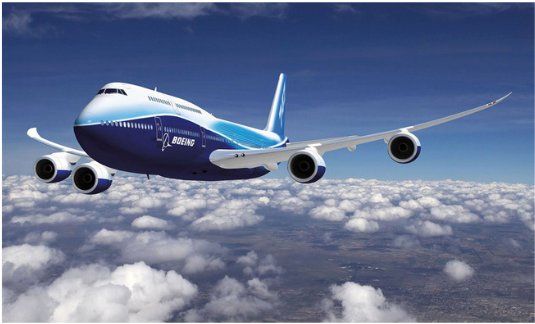
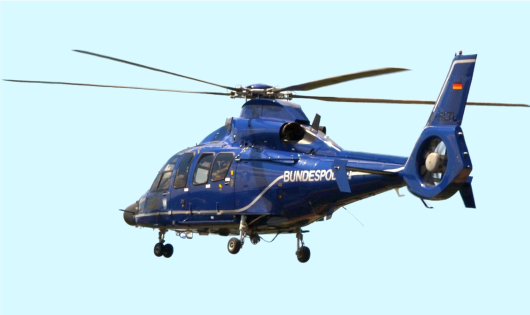
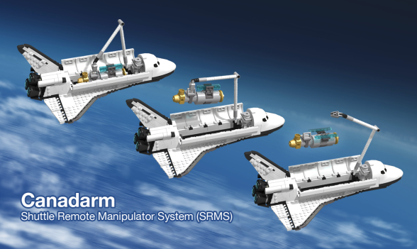
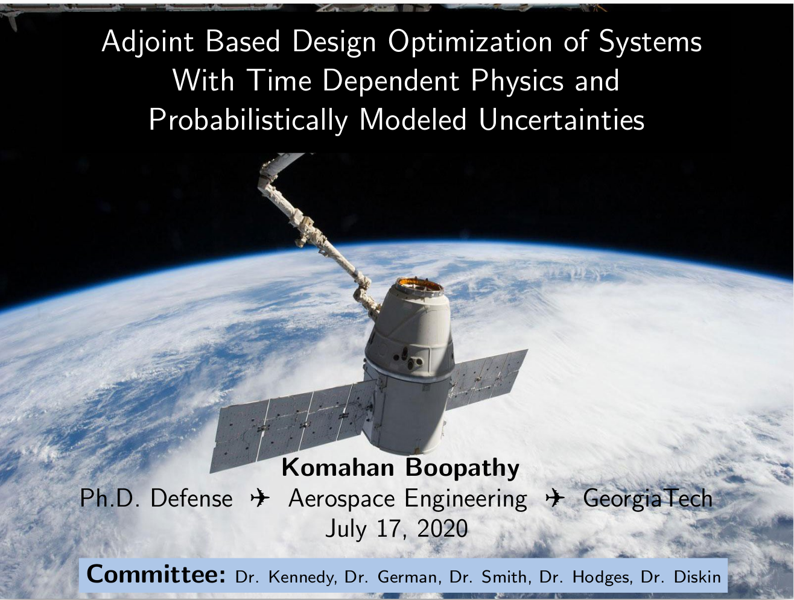
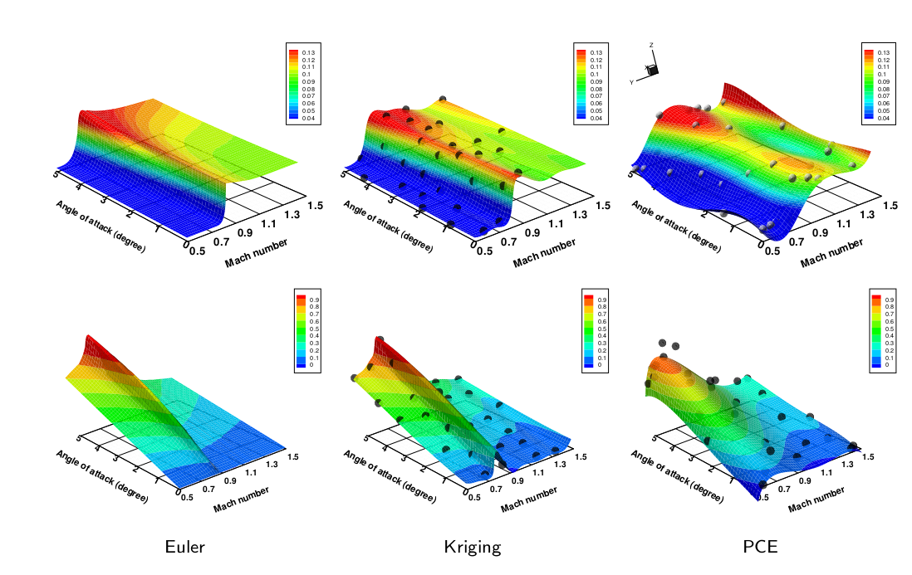

I am a Senior R&D Engineer at Synopsys (Ansys), working on the Fluent GPU solver. I serve on the [AIAA Technical Committees](https://aiaa.org/get-involved/committees-groups/technical-committees/) for Multidisciplinary Design Optimization (MDO) and Uncertainty Quantification (UQ, formerly Non-Deterministic Approaches, NDA).

---

## Research Objective

{::nomarkdown}

{:/}

---

## Passion

My passion lies in crafting simulation frameworks that mathematically model and computationally analyze the equilibrium of aerospace vehicle components with their environmental surroundings and operational conditions. My motivation is to provide computational infrastructure for their design improvements through access to the statistics of quantities of interest and their corresponding sensitivities to design choices. Thus, I undertake, as well as take part in, the development of scalable, flexible and robust computational frameworks -- for scientific computing and targeted applications in aerospace vehicle design contexts such as fixed-wing aircraft, rotorcraft and space system robotic arms.

<!--  whether through perturbations of variables in a given design configuration, or permutations and combinations of various design configurations.  -->

| {:target="_blank" rel="noopener"} |  |  |
| :--------------------------: | :---------------------------: | :-----------------------------: |
| [Aircraft Design](https://claude.ai/artifact/TFwb3RCouBHupcufgPQzeE){:target="_blank" rel="noopener"} |       Rotorcraft Design       |      Space Systems Design       |

**Aircraft design, phase by phase:** [Conceptual](https://claude.ai/artifact/TFwb3RCouBHupcufgPQzeE){:target="_blank" rel="noopener"}: shape an aircraft and fly it (interactive) &rarr; Preliminary: optimize the shape of a fixed configuration (in preparation) &rarr; Detail: optimize the topology of the structure (in preparation)

---

## Graduate Research

I hold a Ph.D. in Aerospace Engineering from the Georgia Institute of Technology, where I conducted research as an assistant in the [SMDO laboratory](https://gkennedy.gatech.edu/) led by [Prof. Graeme Kennedy](https://scholar.google.com/citations?user=LHqGhxkAAAAJ&hl=en).

- I concentrated on the development of a computational [flexible multibody dynamics framework](https://github.com/smdogroup/tacs) with adjoint sensitivity analysis capabilities for the NASA Langley Research Center's [rotorcraft design applications](https://www.youtube.com/watch?v=-HM0KycBvnA). The deterministic framework provides access to high-fidelity data on the underlying physics and accurate gradients crucial for carrying out design improvement cycles in the context of aerospace vehicle design.

  

    

      <!-- Coupled aerodynamic and structural response -->
      <iframe width="640" height="360" src="https://www.youtube.com/embed/-HM0KycBvnA" 
      frameborder="0" allow="accelerometer; autoplay; clipboard-write; encrypted-media; 
      gyroscope; picture-in-picture; web-share" allowfullscreen></iframe>
      
<strong>Coupled aerodynamic and structural response of blades in response to kinematic control inputs from push rods tilting the swash-plate.</strong>

    

  

- This deterministic computational framework was also naturally generalized into an [adjoint-enabled stochastic finite-element, flexible multibody dynamics framework](https://github.com/komahanb/stacs). The stochastic framework is capable of providing access to statistical information on the quantities from aerospace structural design, and the corresponding adjoint gradients.

I also hold a Master's degree in Aerospace Engineering from the University of Dayton, where I worked as a research assistant in [Prof. Markus Rumpfkeil's](https://scholar.google.com/citations?user=zCRdVjYAAAAJ&hl=en) CFD laboratory.

-  I focused on the development of applied methods for aerodynamic shape optimization under uncertainty using surrogate models, as well as  mathematical techniques in abstraction for multi-surrogate-based error-estimation and training-point-selection -- utilizing higher-order derivatives and variable-fidelity training data.

For more detailed information, the theses and associated presentations shall be accessed below:

| Degree | Program               | School                          | Year         | Thesis                                                       | Slides                                                       |
| ------ | --------------------- | ------------------------------- | ------------ | ------------------------------------------------------------ | ------------------------------------------------------------ |
| Ph.D   | Aerospace Engineering | Georgia Institute of Technology | 2015 -- 2020 | [Adjoint Based Design Optimization of Systems with Time Dependent Physics and Probabilistically Modeled Uncertainties](http://hdl.handle.net/1853/63658) |  |
| M.S    | Aerospace Engineering | University of Dayton            | 2012 -- 2014 | [Uncertainty Quantification and Optimization Under Uncertainty Using Surrogate Models](http://rave.ohiolink.edu/etdc/view?acc_num=dayton1398302731) |  |



    
    

        <h3>{{ count }}. <a href="{{ post.url }}">{{ post.title }}</a></h3>
        
        
        
{{ post.image-caption }}

        
    

    
    


---

# [Curriculum Vitae](/files/KomahanBoopathyCV.pdf)

<iframe src="../files/KomahanBoopathyCV.pdf#navpanes=0&pagemode=none" width="100%" height="500"  frameborder="yes" border="10" marginwidth="10"  marginheight="10"></iframe>

