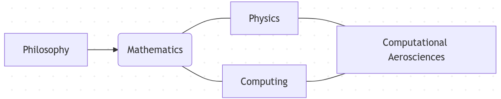
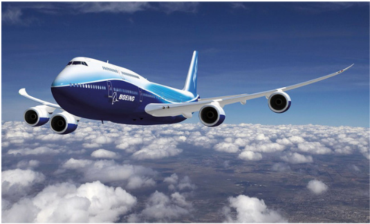
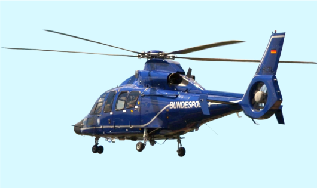
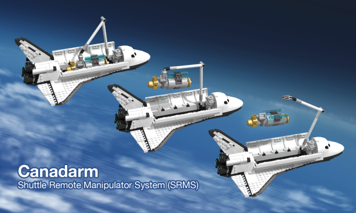
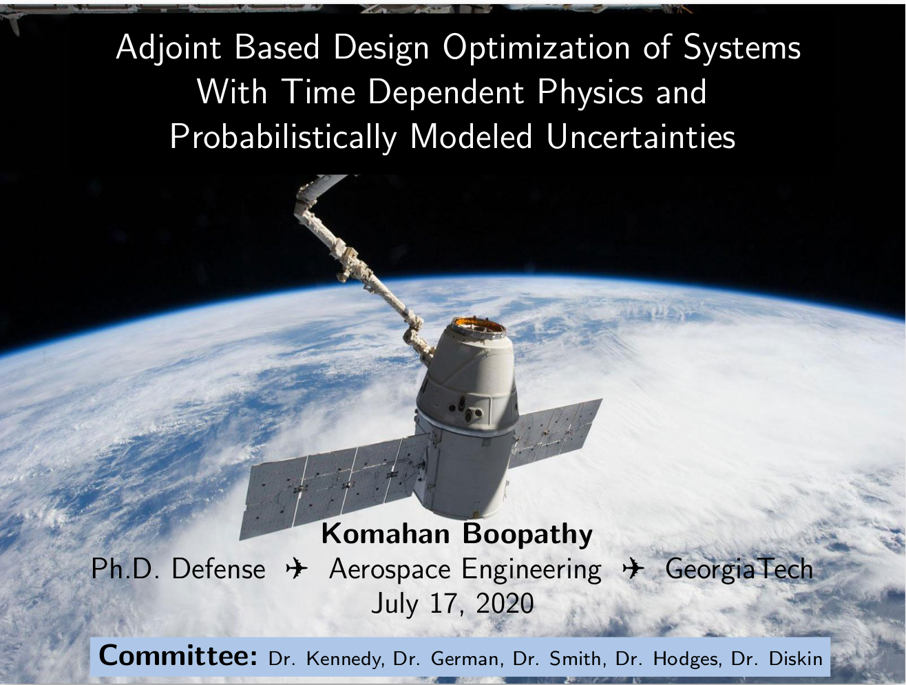
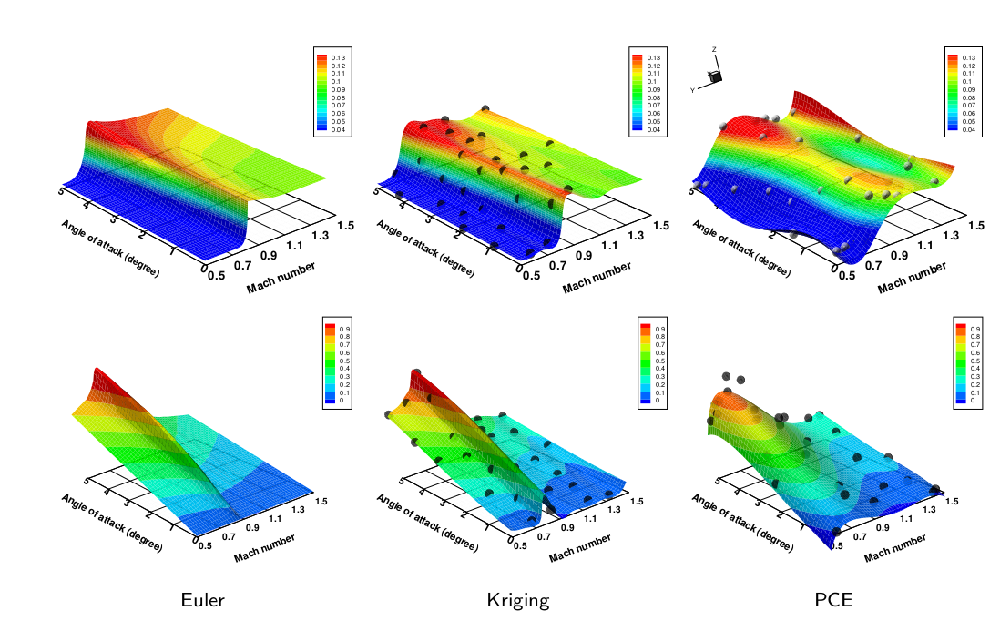

I am a Research Engineer at Synopsys (Ansys), working on the Fluent GPU solver. I serve on the [AIAA Technical Committees](https://aiaa.org/get-involved/committees-groups/technical-committees/) for Multidisciplinary Design Optimization (MDO) and Uncertainty Quantification (UQ, formerly Non-Deterministic Approaches, NDA).

## Philosophy: Eulerian Minimization of Lagrangian Scalars
My ambition is to develop scalable and robust computational infrastructure through foundational research spanning across physics, mathematics and computing for applications at the intersection of **Multidisciplinary Optimization Under Uncertainty (MDOUU)** and **Artificial Intelligence (AI)**.

In contemporary scientific understanding, both MDOUU and AI are broad and distinctive disciplinary areas, but they share a common philosophical trait, and that's what excites me more than anything! They are both optimization statements that minimize an Objective subject to some Constraints.

This is what **Leonard Euler** wrote: *"....nothing at all takes place in the Universe in which a rule of maximum or minimum does not arise"*, and I recognize that these are instantiations of the Eulerian school of thought. Therefore, one computational infrastructure should be able to support both MDOUU and AI (if one were to place their trust in Euler's intuitions :D). From my standpoint, MDOUU and AI are actually Optimization Under Uncertainty (OUU) statements involving the Expectation and Variance of metrics (e.g., minimize an expected loss and its variance, not mere loss!).

What is that one object that combines an objective and constraints and is itself subject to conditions of stationarity for a purpose? Obviously, it is the Lagrangian (due to **J. L. Lagrange** for his work on Analytical Mechanics). He brilliantly ``engineered a scalar`` whose derivatives, when equated to zero, yielded the physics. I understand, recognize, formalize and extend the Lagrangian school of thought to hypothesize that, in addition to physics, sensitivity analysis and design optimizations are derivable from stationarities of Lagrangians, as are the innermost linear solvers, which are essentially `MINRES Operations`.

In short, my philosophy is in the same spirit as Euler-Lagrange equations: derive everything based on Lagrangians, so that the computational infrastructure is merely hierarchical Minimization of Residuals (mathematically) or Stationarity of Lagrangians (physically).

Yet another of Euler's masterpieces is Graph Theory. I have no doubt that the conceived computational infrastructure will look visually like a ``Network of Graphs`` (in abstraction) or like a ``Network of Lagrangians`` that are tuned (in concretion). The evidence is also in plain sight: Neural Networks that form the foundation of AI are nothing but a Network of Graphs!

I develop these ideas through the physics examples in [Engineering a Lagrangian for Physics, Sensitivity, and Design](/projects/common-mathematics-physics-design/).

## Passion

My passion lies in crafting simulation frameworks that mathematically model and computationally analyze the equilibrium of aerospace vehicle components with their environmental surroundings and operational conditions. My motivation is to provide computational infrastructure for their design improvements through access to the statistics of quantities of interest and their corresponding sensitivities to design choices. Thus, I undertake, as well as take part in, the development of scalable, flexible and robust computational frameworks -- for scientific computing and targeted applications in aerospace vehicle design contexts such as fixed-wing aircraft, rotorcraft and space system robotic arms.

<!--  whether through perturbations of variables in a given design configuration, or permutations and combinations of various design configurations.  -->

|  |  |  |
| :--------------------------: | :---------------------------: | :-----------------------------: |
|       Aircraft Design        |       Rotorcraft Design       |      Space Systems Design       |

<b>

## Graduate Research

I hold a Ph.D. in Aerospace Engineering from the Georgia Institute of Technology, where I conducted research as an assistant in the [SMDO laboratory](https://gkennedy.gatech.edu/) led by [Prof. Graeme Kennedy](https://scholar.google.com/citations?user=LHqGhxkAAAAJ&hl=en).

- I concentrated on the development of a computational [flexible multibody dynamics framework](https://github.com/smdogroup/tacs) with adjoint sensitivity analysis capabilities for the NASA Langley Research Center's [rotorcraft design applications](https://www.youtube.com/watch?v=-HM0KycBvnA). The deterministic framework provides access to high-fidelity data on the underlying physics and accurate gradients crucial for carrying out design improvement cycles in the context of aerospace vehicle design.

  

    

      <!-- Coupled aerodynamic and structural response -->
      <iframe width="640" height="360" src="https://www.youtube.com/embed/-HM0KycBvnA" 
      frameborder="0" allow="accelerometer; autoplay; clipboard-write; encrypted-media; 
      gyroscope; picture-in-picture; web-share" allowfullscreen></iframe>
      
<strong>Coupled aerodynamic and structural response of blades in response to kinematic control inputs from push rods tilting the swash-plate.</strong>

    

  

- This deterministic computational framework was also naturally generalized into an [adjoint-enabled stochastic finite-element, flexible multibody dynamics framework](https://github.com/komahanb/stacs). The stochastic framework is capable of providing access to statistical information on the quantities from aerospace structural design, and the corresponding adjoint gradients.

I also hold a Master's degree in Aerospace Engineering from the University of Dayton, where I worked as a research assistant in [Prof. Markus Rumpfkeil's](https://scholar.google.com/citations?user=zCRdVjYAAAAJ&hl=en) CFD laboratory.

-  I focused on the development of applied methods for aerodynamic shape optimization under uncertainty using surrogate models, as well as  mathematical techniques in abstraction for multi-surrogate-based error-estimation and training-point-selection -- utilizing higher-order derivatives and variable-fidelity training data.

For more detailed information, the theses and associated presentations shall be accessed below:

| Degree | Program               | School                          | Year         | Thesis                                                       | Slides                                                       |
| ------ | --------------------- | ------------------------------- | ------------ | ------------------------------------------------------------ | ------------------------------------------------------------ |
| Ph.D   | Aerospace Engineering | Georgia Institute of Technology | 2015 -- 2020 | [Adjoint Based Design Optimization of Systems with Time Dependent Physics and Probabilistically Modeled Uncertainties](http://hdl.handle.net/1853/63658) |  |
| M.S    | Aerospace Engineering | University of Dayton            | 2012 -- 2014 | [Uncertainty Quantification and Optimization Under Uncertainty Using Surrogate Models](http://rave.ohiolink.edu/etdc/view?acc_num=dayton1398302731) |  |



    
    

        <h3>{{ count }}. <a href="{{ post.url }}">{{ post.title }}</a></h3>
        
        
        
{{ post.image-caption }}

        
    

    
    


<b>

# [Curriculum Vitae](/files/KomahanBoopathyCV.pdf)

<iframe src="../files/KomahanBoopathyCV.pdf" width="100%" height="500"  frameborder="yes" border="10" marginwidth="10"  marginheight="10"></iframe>
