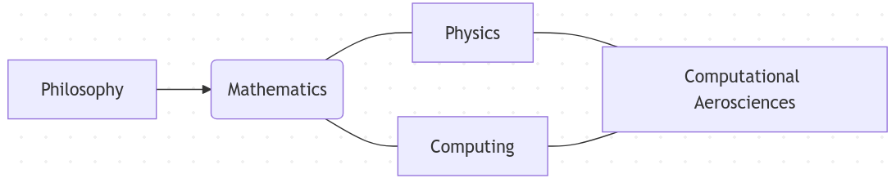
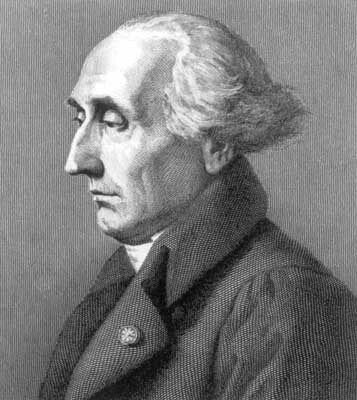
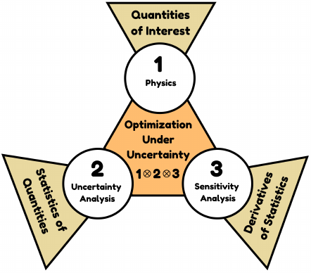
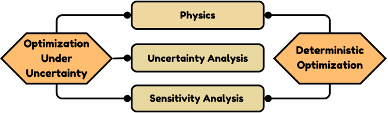
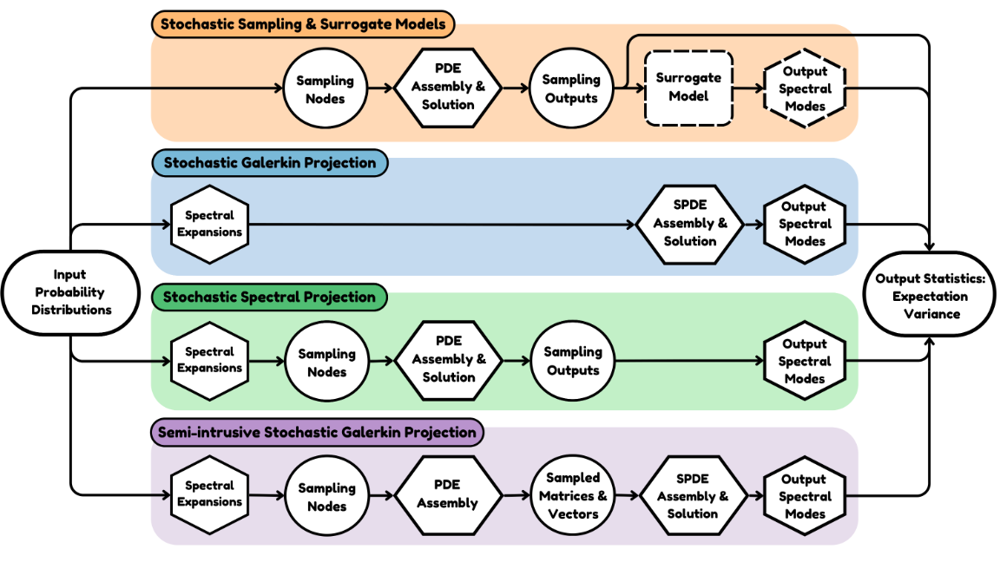
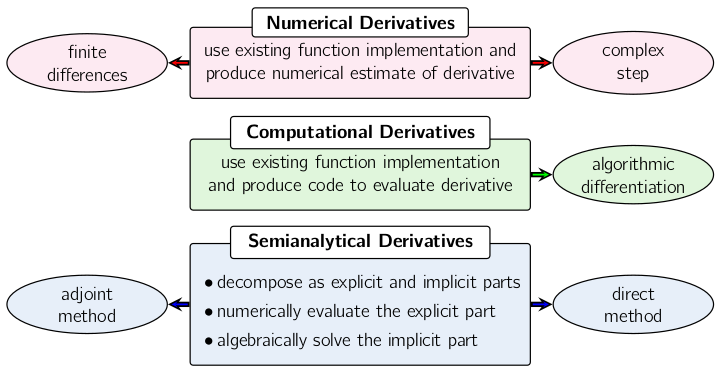
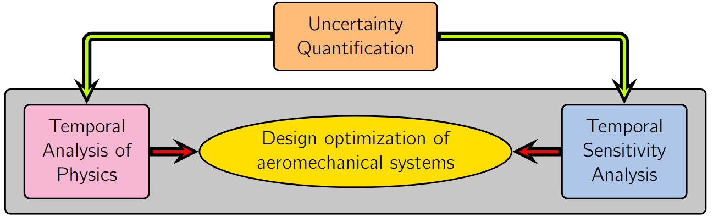

In this following summary of my research, I emphasize the technical aspects and the underlying philosophy as much as possible. For focused technical discussions, please review this [page]({{site.baseurl}}/publications). 

---

## Philosophy: Eulerian Minimization of Lagrangian Scalars
My ambition is to develop scalable and robust computational infrastructure through foundational research spanning across physics, mathematics and computing for applications at the intersection of **Multidisciplinary Optimization Under Uncertainty (MDOUU)** and **Artificial Intelligence (AI)**.

In contemporary scientific understanding, both MDOUU and AI are broad and distinctive disciplinary areas, but they share a common philosophical trait, and that's what excites me more than anything! They are both optimization statements that minimize an Objective subject to some Constraints.

This is what **Leonhard Euler** wrote in 1744: *"...nothing at all takes place in the universe in which some rule of maximum or minimum does not appear"*, and I recognize that these are instantiations of the Eulerian school of thought. Therefore, one computational infrastructure should be able to support both MDOUU and AI (if one were to place their trust in Euler's intuitions :D). From my standpoint, MDOUU and AI are actually Optimization Under Uncertainty (OUU) statements involving the Expectation and Variance of metrics (e.g., minimize an expected loss and its variance, not mere loss!).

I see **Genichi Taguchi**'s robust design as an engineering-centric application of this Eulerian school of thought, which my work on optimization under uncertainty, described below, puts into practice for aerospace systems.

What is that one object that combines an objective and constraints and is itself subject to conditions of stationarity for a purpose? Obviously, it is the Lagrangian (due to **J. L. Lagrange** for his work on Analytical Mechanics). He brilliantly ``engineered a scalar`` whose derivatives, when equated to zero, yielded the physics. I understand, recognize, formalize and extend the Lagrangian school of thought to hypothesize that, in addition to physics, sensitivity analysis and design optimizations are derivable from stationarities of Lagrangians, as are the innermost linear solvers, which are essentially `MINRES Operations`.

<!-- Side by side at equal heights on every screen: each portrait's share of the row is its width-to-height ratio (387/500 and 357/400). -->

<figure style="display: block; flex: 774 1 0; min-width: 0; margin: 0; text-align: center;">

<figcaption style="font-size: 0.9em;"><b>Leonhard Euler [1707 — 1783]</b> Portrait by J. E. Handmann, 1753</figcaption>
</figure>
<figure style="display: block; flex: 893 1 0; min-width: 0; margin: 0; text-align: center;">

<figcaption style="font-size: 0.9em;"><b>Joseph-Louis Lagrange [1736 — 1813]</b> Engraving, artist unknown</figcaption>
</figure>

In short, my philosophy is in the same spirit as Euler-Lagrange equations: derive everything based on Lagrangians, so that the computational infrastructure is merely hierarchical Minimization of Residuals (mathematically) or Stationarity of Lagrangians (physically).

Yet another of Euler's masterpieces is Graph Theory. I have no doubt that the conceived computational infrastructure will look visually like a ``Network of Graphs`` (in abstraction) or like a ``Network of Lagrangians`` that are tuned (in concretion). The evidence is also in plain sight: Neural Networks that form the foundation of AI are nothing but a Network of Graphs!

---

{::nomarkdown}

{:/}

<figure style="text-align: center; width: 300px; margin: auto;">
 
<figcaption style="font-size: 1.0em;">A product should be designed in such a way that makes its performance insensitive to variation in variables beyond the control of the designer. <b>Genichi Taguchi [1924 — 2012] </b></figcaption></figure>

The primary motivation is to produce robust and reliable aerospace designs aligned with Genichi Taguchi's view. The application of optimization under uncertainty (OUU) methods, in the context of aerospace design-optimization, provides a systematic way to achieve the desired stochastic response characteristics in aerospace vehicles. My focus is on the development of stochastic simulation infrastructure to provide the key ingredients needed for OUU, namely:

- access to high-fidelity deterministic and stochastic physics simulations to analyze the effect of design changes on the underlying laws of physical equilibrium  

- access to design variable gradients of the quantities of interest that feed into optimization frameworks to calculate further design improvements  

- access to mean, variance, and standard deviation of the spatio-temporal quantities and their corresponding design variable gradients through the application of the adjoint method

<table style="width: 100%; border-collapse: collapse;">
  <tr>
    <td style="text-align: center;">
      
    </td>
    <td style="text-align: center;">
      
    </td>
  </tr>
  <tr>
    <td style="text-align: center;">
      OUU is in the span of (1), (2) and (3)
    </td>
    <td style="text-align: center;">
      Deterministic Optimization is in the span of (1) and (3)
    </td>
  </tr>
</table>

The elements of this infrastructure are connected to **Deterministic Optimization (DO)** and **Optimization Under Uncertainty (OUU)** algorithms as needed for aerospace applications.

{::nomarkdown}

{:/}

---

{::nomarkdown}

{:/}

### (I) Uncertainty Propagation Methods through PDE Models

I explore the application of probabilistic extensions to deterministic frameworks for synthesizing new methods of uncertainty propagation through PDEs. In this context, I recognize freedom in the sequence of application of spatial, temporal and probabilistic domain principles.  I adopt the philosophy of structuring stochastic calculations around deterministic calculations -- a choice that aids in natural, modular extensions that reuse capabilities implemented in deterministic space-time (DST) when computations are carried out in probabilistic space-time (PST).

<figure style="text-align: center; width: 100%;">
  
  <figcaption style="font-size: 1.0em;">Figure: A schematic representation of combinatorics in the placement of sampling and spectral expansion principles forming different UQ methods. The use of sampling reduces intrusiveness. </figcaption>
</figure>

One of the key outcomes of my research in this context, is the development of the **[Semi-Intrusive Stochastic Galerkin Projection Method](https://komahanb.github.io/journals/ssgm-ouu-canadarm/)**, which is a *simplified* (*samplified*) version of the Stochastic Galerkin method. This method draws from:
- the flexibility in the order of discretization and integration across the probabilistic space-time (PST) domain.
- the mathematical construction that connects *sampling* and *projection* through *stochastic inner products*, exploiting their invariance to the method of evaluation, whether analytical, numerical, or experimental.

Apart from the technical contribution, it is deeply satisfying from a philosophical perspective to witness the harmonious functioning of seemingly disparate concepts—**sampling** and **projection**. A long-standing challenge, which has slowed the Galerkin projection's advancement for roughly two decades, is resolved through an integrated application of these principles. 

> The potential to extend this synthesis to other configurations drives my ongoing research within OUU. My philosophy here is to implement methods such that *projection lends the basis for sampling* and *sampling lends the means for projection*, forming a mutually beneficial arrangement.

<figure style="text-align: center; width: 300px; margin: auto;">
  
  <figcaption style="font-size: 1.0em;">As long as algebra and geometry have been separated, their progress **has** been slow and their uses limited; but when these two sciences have been united, they have lent **each other mutual** forces and marched together towards perfection. <b>J. L. Lagrange [1736 — 1813]</b></figcaption>
</figure>
{::nomarkdown}

{:/}

---

{::nomarkdown}

{:/}

### (II) Computational Sensitivity Analysis Methods

My research in this subspace is along two trajectories: (i) to obtain derivatives necessary to solve large scale optimization problems from aerospace vehicle design, and (ii) explorations into the integration of sensitivity analysis within the context of linear/non-linear solution algorithms.

#### <u>The Adjoint Method for Design Variable Derivatives</u>

My special interest is on the adjoint-based methods for sensitivity analysis. It offers scalability in terms of the number of design variables. I have focused on formulating and implementing sensitivity analysis methods in the time-domain with several order-agnostic multi-step and multi-stage time methods in deterministic-space-time (DST). This study uncovers the broader structure of the discrete-adjoint equations:

> Although the schemes come with various forms, the overarching structure that is common to all schemes is that the partial derivatives of the residuals and functions can be combined using different weights to implement the discrete adjoint methods. 

#### <u>The Adjoint Method in Artificial Intelligence</u>

The adjoint method, traditionally used in optimization and sensitivity analysis, provides a framework for efficiently computing the derivatives of output quantities of interest with respect to input variables. 

> This method has deep connections with modern AI techniques, particularly in machine learning. AI models, especially neural networks, can be viewed as an implementation of the adjoint method, where the back-propagation algorithm is used to compute gradients in a manner analogous to adjoint sensitivity analysis. 

In both contexts, the efficient computation of these gradients enables large-scale optimization across complex systems, bridging analytical methods with modern computational intelligence.

#### <u>Higher-Dimensional Numbers Based On Algebraic Structures and Differential Operators</u>

I study the construction of higher-dimensional numbers that can provide first, second, and other higher-order derivatives, when needed. This research is building upon the observations from complex-number arithmetics to four-, and eight-dimensional numbers.

<figure style="text-align: center; width: 300px; margin: auto;">
 
<figcaption style="font-size: 1.0em;">... the idea of enlarging reality by including “tentative” possibilities and then selecting one of these by the condition that it minimizes a certain quantity, seems to bring purpose to the flow of natural events. <b>Cornelius Lanczos [1893–1974] </b></figcaption>
</figure>
{::nomarkdown}

{:/}

---

{::nomarkdown}

{:/}

### (III) Computational Methods for High Fidelity Spatio-Temporal Physics

The goal is to mathematically model physical phenomena of interest and computationally analyze the phenomena for the different input space-time geometries from aerospace engineering vehicle design contexts. 

  

    <!-- Standalone structural response of helicopter rotor dynamics -->
    <iframe width="640" height="360" src="https://www.youtube.com/embed/avUd3ivnw8k" 
    frameborder="0" allow="accelerometer; autoplay; clipboard-write; encrypted-media; 
    gyroscope; picture-in-picture; web-share" allowfullscreen></iframe>
    
<strong>The flexible multibody dynamics simulation of rotorcraft hub assembly using the finite-element integration in spatial-domain, and the diagonally implicit Runge--Kutta integration in time-domain.</strong>

  

#### <u>Mathematical Physics</u>

<b>

<strong> Often the mathematical models of physics are heavily reliant on the assembly of forces from various sources by following the philosophy of Newton.</strong> 

This philosophy works well for problems that are isolated or primarily governed by a single set of principles, like mechanics or electromagnetism in simpler contexts. This will not be readily applicable in situations where there is an inherent scope for lack of intuition such as multidisciplinary and multi-physics application contexts. The Newtonian approach might oversimplify or ignore the interconnectedness and emergent behaviors that are not easily explained by the sum of forces alone. Philosophically, this calls into question whether physical phenomena are best understood as discrete forces or if a more holistic framework -- where different disciplines and forces are interconnected in a way that the Newtonian paradigm does not capture --  might be more suitable. 

Intrigued by this philosophical question, I study methods to standardize the process of obtaining governing equations of physical systems based on the prediction capabilities of mathematics, focusing first on the mechanics of fluids and solids. This way ,even if the physical intuition is not available immediately, the mathematical logic would provide the accurate set of governing equations necessary for simulations with varying measures of fidelity. I have used elements of this philosophy in my research work on the stochastic extensions of deterministic physics and adjoint derivatives, and demonstrated considerable success in this regard. I am excited to push this philosophy into the broader space of mathematical physics, and apply the technical advances back in the context of aerospace design.

<figure style="text-align: center; width: 300px; margin: auto;">      <figcaption style="font-size: 1.0em;">   The  <i>Father of Analytical Geometry</i> for his work in uniting algebra and geometry that laid the foundation for modern analytical geometry, which uses algebraic equations to describe geometric shapes.         <b>René Descartes [1596 — 1650]</b>   </figcaption> </figure>

#### <u>Computational Mathematics</u>

<b>

I adopt abstracted mathematical models with generic forms and wire their state and design variable derivatives to implement the numerical solution framework. 

- For implementation of the solution framework, the residuals and their state derivatives (Jacobian) are wired into linear and nonlinear solution methods.

- For adjoint implementation, the abstracted functions, and their state and design variable derivatives are sufficient to implement an adjoint gradient assembly framework. 

I take a <strong> physics-agnostic </strong>perspective to keep the implementation abstracted from the physics, and thus the framework can be configured in different ways for the particular problem setup. This holds in a logical sense because the physical interpretation of what the states are in reality does not matter to computational mathematics frameworks.

{::nomarkdown}

{:/}